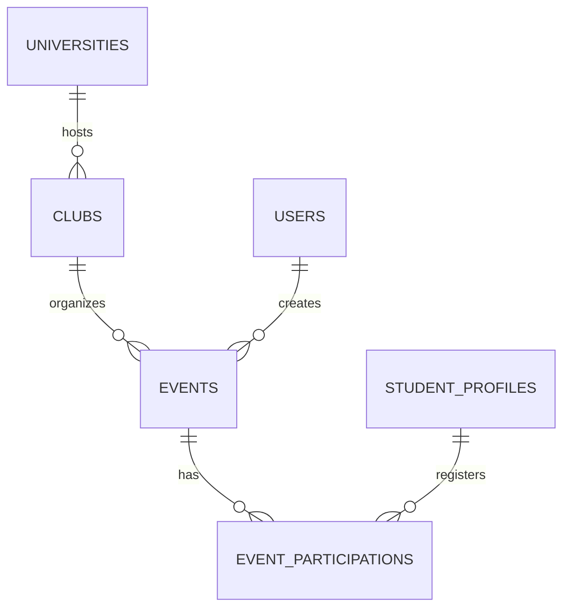

# Campus+ — Event ve EventParticipation tasarımı

Tarih: 2026-10-31. Durum: **kod ve testler tamamlandı; V006 ana ve test DB'de
onayla uygulandı.** [Ana DB doğrulaması](event-main-validation.md).
Mevcut Java 21 / Boot 4.1.1 / Security 7 / JWT / JPA / PostgreSQL 17 yapısı korunur.
Bu belge SQL uygulama onayı değildir. Commit/push ayrıca istenir.
[Kod aşaması](event-phase1-review.md) ve [güncel canlı doğrulama](event-test-validation.md).

## 1. Kod tabanından doğrulanan başlangıç

- `ClubPolicy` ADMIN ile güncel CLUB_ADMIN + ilgili ACTIVE OWNER/MANAGER üyeliğini
  ayırıyor. Kurucu kimliği veya token'daki rol tek başına yönetim yetkisi değil.
- `ClubWorkspace` kullanıcıları artan ID, ardından kulüp/üyelik sırasıyla kilitliyor;
  OSIV/JWT sırasında yüklenmiş entity'leri kilitten sonra refresh ediyor.
- `StudentProfilePolicy` üniversite değişiminde şu an yalnız kulüp üyeliklerini kontrol ediyor.
  Üniversite öğrencilerine açık etkinlikler için bu kontrol genişletilmeli.
- Son yerel sonuç 193 unit + 10 PostgreSQL IT / 23 Python testi başarılı.
- Son gönderilen `d0b250e` için [GitHub CI](https://github.com/cemsoylemezoglu/campus-plus-backend/actions/runs/41144506168)
  **unit ve postgres işleri başarılı**. Çalışma başlangıcında Git ağacı temizdi.
- Ana DB history'si BASELINE 5; yeni test DB history'si gerçek SQL V005.
  Yeni tablolar için sıradaki sürüm V006; iki kurulum yolu aynı son şemaya ulaşmalı.

## 2. Ürün kuralları — onaya sunulan varsayılanlar

- Etkinlik bir kulübe bağlıdır. Üniversite kulüpten türetilir; bağımsız ikinci university_id
  tutulup çelişen kurum bağlantısı yaratılmaz. Kulüp sonradan taşınmaz.
- Etkinliği ilgili OWNER/MANAGER veya ADMIN taslak olarak oluşturup yayımlar.
  Kulüp zaten ADMIN onaylı olmalıdır; etkinlik için ayrıca kulüp onay süreci tekrarlanmaz.
- Katılım politikası etkinlik bazında seçilir: `UNIVERSITY_STUDENTS` (varsayılan) veya
  `CLUB_MEMBERS`. Her ikisinde de aktif üniversite ve aynı üniversitede öğrenci profili gerekir.
  İkinci politikada ayrıca ilgili kulüpte ACTIVE üyelik gerekir; OWNER/MANAGER da üyedir.
- Kayıt, şartlar uygunsa doğrudan onaylanır. Kontenjan nullable ise sınırsız, doluysa
  pozitif kapasitedir. Bir kullanıcı bir etkinlikte tek güncel katılım kaydı taşır.
- Kayıt iptali kontenjanı açar; kayıt aralığında güncel sürümle yeniden kayıt mümkündür.
  Yönetici tarafından çıkarılmış kişi açık yeniden kayıt izni olmadan geri dönemez.
- Katılım/attendance birbirinden ayrılır: kayıt olmak fiziksel katılım kanıtı değildir.
  Giriş kontrolünü ilgili yönetici yapar; öğrenci kendi kendine ATTENDED yazamaz.
- Ana platform kapsamı (sosyal akış, duyuru, yorum/beğeni, bildirim, mesajlaşma,
  moderasyon, Flutter ve yayınlama) korunur. Yeni bağımlılık veya ayrı servis gerekmez.

## 3. Tablolar ve JPA

### events

| Alan | Tip / kural |
| --- | --- |
| id | BIGINT BY DEFAULT identity PK |
| club_id | NOT NULL FK clubs, değişmez, ON DELETE RESTRICT |
| created_by | NOT NULL FK users, değişmez; yönetim yetkisinin kaynağı değil |
| title / description | VARCHAR(200) / VARCHAR(10000), NOT NULL, trim sonrası boş olamaz |
| venue | VARCHAR(500), NOT NULL, görünen etkinlik konumu |
| cover_url | VARCHAR(500), nullable; mevcut HttpWebsite yaklaşımı, sunucu URL'yi indirmez |
| status | VARCHAR(20), DRAFT / PUBLISHED / CANCELLED / COMPLETED |
| audience | VARCHAR(24), UNIVERSITY_STUDENTS / CLUB_MEMBERS |
| capacity | INTEGER nullable, CHECK null veya >0; API üst sınırı 100000 |
| registration_opens_at / registration_closes_at | TIMESTAMPTZ, NOT NULL |
| starts_at / ends_at | TIMESTAMPTZ, NOT NULL |
| time_zone | VARCHAR(64), NOT NULL; Java ZoneId kataloğunda geçerli bölge |
| published_at | TIMESTAMPTZ nullable; ilk yayımlama zamanı |
| cancelled_at / cancelled_by / cancellation_reason | nullable TIMESTAMPTZ / users FK / VARCHAR(1000) |
| completed_at | TIMESTAMPTZ nullable |
| archived_at | TIMESTAMPTZ nullable; terminal durumdan sonra listeden kaldırma |
| schedule_changed_at / schedule_change_reason | nullable TIMESTAMPTZ / VARCHAR(1000); son erteleme bilgisi |
| created_at / updated_at / version | TIMESTAMPTZ NOT NULL / BIGINT NOT NULL DEFAULT 0 |

Statik CHECK: opens < closes <= starts < ends; status/audience değerleri; capacity;
version >=0; CANCELLED için iptal zamanı/actor/boş olmayan gerekçe; COMPLETED için
completed_at; archived_at yalnız CANCELLED/COMPLETED durumunda dolu olabilir.
Zamanın ilerlemesine bağlı `now()` CHECK kullanılmaz. ZoneId geçerliliği servis/validation
katmanında kontrol edilir; DB uzunluk/boşluk kontrolü tam IANA doğrulaması gibi sunulmaz.

İndeksler: `(club_id, status, starts_at, id)` ve aktif keşif için
`(status, starts_at, id) WHERE archived_at IS NULL`. İptal actor FK'si için uygun indeks.
Sorgulara göre mevcut PK ve indeksler incelenerek gereksiz tekrar eklenmez.

### event_participations

| Alan | Tip / kural |
| --- | --- |
| id | BIGINT BY DEFAULT identity PK |
| event_id | NOT NULL FK events, değişmez, ON DELETE RESTRICT |
| user_id | NOT NULL FK student_profiles.user_id, değişmez, ON DELETE RESTRICT |
| status | VARCHAR(16): REGISTERED / CANCELLED / REMOVED / ATTENDED / NO_SHOW |
| registered_at | TIMESTAMPTZ NOT NULL; en son kayıt zamanı |
| ended_at | TIMESTAMPTZ nullable; iptal/çıkarılma/no-show zamanı |
| ended_by | users FK nullable; işlem actor'ı, sistemsel completion'da tamamlayan yönetici |
| end_cause | VARCHAR(32) nullable; SELF_CANCELLED / EVENT_CANCELLED / MEMBERSHIP_ENDED / CLUB_ARCHIVED / REMOVED / REAPPLICATION_ALLOWED / NO_SHOW |
| decision_reason | VARCHAR(1000) nullable; yalnız kişi ve yetkili yöneticiye açık |
| checked_in_at / checked_in_by | TIMESTAMPTZ nullable / users FK nullable |
| created_at / updated_at / version | TIMESTAMPTZ NOT NULL / BIGINT NOT NULL DEFAULT 0 |

`UNIQUE(event_id,user_id)`; REGISTERED için ended/check-in alanları boş; ATTENDED için
check-in zamanı/actor dolu, ended alanları boş; CANCELLED/REMOVED/NO_SHOW için ended
zamanı/actor/cause dolu ve check-in alanları boş. REMOVED için özel gerekçe zorunlu.
İndeksler `(event_id,status,id)` ve `(user_id,status,event_id)`; reviewer FK'leri için
silme kontrollerinin maliyeti SQL incelemesinde değerlendirilir.

Tekrar kayıt aynı satırı REGISTERED yapar, güncel tur alanlarını temizler ve registered_at'i
yeniler; created_at değişmez. Bu iki model tam, değişmez işlem/audit geçmişi iddiası taşımaz.
Genel audit modülü sonraki entegrasyon noktasıdır.

Event → Club/createdBy/cancelledBy, Participation → Event/StudentProfile/endedBy/checkedInBy
ilişkileri LAZY ManyToOne olur. `@Version Long`, EnumType.STRING, Instant kullanılır.
Cascade REMOVE/ALL/orphanRemoval yoktur; büyük parent koleksiyonları eklenmez.
Entity serialize edilmez. DTO mapping transaction içinde, sayfalı DTO projection veya
hedefli EntityGraph ile yapılır; page sorgusunda collection fetch join kullanılmaz.

## 4. Yaşam döngüsü, saat ve kontenjan

Event: DRAFT → PUBLISHED → COMPLETED; DRAFT/PUBLISHED → CANCELLED.
İptal geri açılmaz; COMPLETED/CANCELLED üzerinde archive işareti konabilir. Fiziksel
silme yoktur. CLUB_MEMBERS gizliliği yayımdan sonra başka audience'a dönüştürülmez.

Etkinlik başladı mı/bitti mi bilgisi Clock üzerinden türetilir; sırf saat geçti diye
arka planda DB status güncelleyici eklenmez. COMPLETED, yönetici eylemiyle ends_at
sonrasında konur; kalan REGISTERED kayıtları aynı transaction'da NO_SHOW yapılır.

- Kayıt aralığı opens <= now < closes; iptal kendi REGISTERED kaydında now < starts.
- Check-in varsayılan olarak starts - 30 dakika <= now <= ends aralığında, PUBLISHED
  ve aktif kulüp/üniversitede, güncel uygunlukla yapılır. Süre EventSettings + Clock ile test edilir.
- **Dolu koltuk sayısı REGISTERED + ATTENDED'dır.** Erken check-in koltuğu boşaltmaz.
- Kapasite azaltımı dolu koltuk sayısının altına inemez. Yeni kayıt/capacity change/
  cancellation/check-in aynı event kilidini kullanır. Ayrı cache sayaç tutulmaz.
- Başlamış veya check-in almış etkinlik yeniden tarihlenmez. Yayımlanmış etkinlikte
  tarih değiştirme ayrı reschedule eylemidir: güncel version, yeni dört tarih/timeZone ve
  boş olmayan gerekçe gerekir. Katılımlar korunur; yeni kayıt aralığı bütün kuralları sağlar.
  Own-participation DTO'su da güncel event version/tarihlerini döndürür.
- Cancellation kalan REGISTERED kayıtlarını aynı transaction'da CANCELLED yapar;
  önceden ATTENDED olan gerçek katılım kaydı korunur. Bu durumda kayıt açılamaz.
- Tarihler JSON'da Z veya açık offset ile mutlak zaman olarak alınır; offset'siz yerel
  saat reddedilir. DB/Java'da Instant; timeZone geçerli ZoneId olarak gösterim bölgesidir.
  Yanıt UTC ISO timestamp ve timeZone içerir; yanıt tarihleri değiştirilmeden tekrar
  istek içinde kullanılabilir. Aynı Instant'ı ifade eden farklı offset'ler eşdeğerdir.
  Mobil tarih seçici DST boşluğu/çift saati için yerel saat→Instant dönüşümünü açık
  kullanıcı seçimiyle çözmelidir; backend offset'siz saati sessizce tahmin etmez.
  Saat karşılaştırmaları için kilit alındıktan
  sonra tek Clock.instant() alınır; kilit beklerken kapanan kayıt penceresi atlanmaz.

## 5. Yetki ve görünürlük

| İşlem | Yetki |
| --- | --- |
| Keşif/liste | JWT gerekli; PUBLISHED, arşivlenmemiş, ACTIVE kulüp; UNIVERSITY_STUDENTS özeti doğrulanmış kullanıcılara açık |
| CLUB_MEMBERS detay/liste | ADMIN veya ilgili aktif kulüp üyesi; yerel yönetim kontrolleri ayrıca uygulanır |
| Taslak/özel yönetim görünümü | ADMIN veya güncel yerel OWNER/MANAGER |
| Oluştur/düzenle/yayımla/reschedule/check-in | ADMIN veya yerel OWNER/MANAGER; aktif kulüp/üniversite; durum/saat kontrolleri |
| İptal/tamamla/arşivle | Yerel yönetici veya ADMIN; askıda/arşivli kulüpte yönetim istisnası yalnız ADMIN |
| Kayıt/tekrar kayıt | Actor'ın kendi uygun profili; açık pencere, güncel event version, kapasite ve audience |
| Kendi kayıtlarını oku/iptal | Yalnız kendi kayıtları; kulüp askıda olsa da zamanı uygunsa kendi iptali mümkün |
| Katılımcı listesi/çıkarma/yeniden kayıt izni | İlgili güncel yönetici veya ADMIN; kişi verileri genel keşif DTO'suna girmez |

Global CLUB_ADMIN, created_by, eski JWT veya başka kulüpteki yöneticilik yetki vermez.
EventPolicy/ParticipationPolicy servis bean'leri ve method security kullanılır; kontroller
kilitlenmiş güncel User/Club/Membership/Event üzerinden tekrarlanır. Admin bütünlük,
kontenjan, saat ve tekil kayıt kurallarını atlayamaz; kendisine öğrenci profili uydurulmaz.

401 authentication, 403 görünür kaynağa yetkisizlik, 404 görünmeyen/yanlış parent'a
bağlı kaynak, 409 durum/version/kapasite/uygunluk çakışması, 400 geçersiz payload.
Event/participation ID, eventId/clubId bağlamına karşı doğrulanır. Kişi adı/e-posta,
bio, parola/hash, özel karar gerekçeleri veya katılımcı listesi keşif yanıtına eklenmez.
Kendi geçmiş kayıtlarında asgari event özeti korunur; bu, eski üyenin gizli etkinlik
detaylarını tekrar okuyabildiği anlamına gelmez. Özel yanıtlar Cache-Control:no-store.

## 6. Mevcut modüllerle transaction entegrasyonu

- CLUB_MEMBERS katılımında üyelik sürekli geçerli olmalıdır. Leave/remove/suspend
  işlemi, ilgili kişinin henüz bitmemiş üyelik gerektiren etkinliklerdeki REGISTERED
  kayıtlarını aynı transaction'da MEMBERSHIP_ENDED nedeniyle iptal eder.
  UNIVERSITY_STUDENTS kayıtları normal üyelikten ayrılınca iptal edilmez.
- Üyelik gerektiren devam eden etkinlikte REGISTERED kayıt da üyelik kaybında iptal
  edilir; ATTENDED geçmişi korunur. Yeniden üyelik eski bileti otomatik açmaz.
- Üniversite değişimi: mevcut kulüp kontrollerine ek olarak, bitmemiş PUBLISHED etkinlikte
  REGISTERED/ATTENDED kaydı varsa 409. Önce uygun iptal/sonlandırma veya etkinliğin
  bitmesi gerekir. Geçmiş katılım profili eski üniversiteye sabitlemez.
- Club archive: taslak/yayımdaki etkinlikler ve kalan REGISTERED biletler aynı transaction'da
  iptal edilir; geçmiş completion/attendance korunur. Sonra mevcut marker rol hesaplaması sürer.
- Club suspend/university inactive: yeni kayıt, yayın ve check-in kapanır; mevcut veri
  silinmez. Kullanıcı iptali ve gerekli ADMIN sonlandırması mümkündür. Restore mevcut
  event tarihlerinin/penceresinin dışına çıkma veya iptal edilmiş bileti canlandırma hakkı vermez.
- Ownership transfer/manager role kaybı event yönetimine sonraki istekte yansır;
  oluşturucuya kalıcı ayrıcalık eklenmez. JWT sözleşmesi değişmez.

### Kilit sırası

Etkilenen kullanıcılar ID ASC → club → gerekiyorsa membership → event ID ASC → participation.
Mevcut kodun users→club→memberships sırası tersine çevrilmez. Event işlemleri club üzerinde
PESSIMISTIC_READ kullanarak club lifecycle/üyelik değişimine karşı koruma sağlar;
event üzerinde PESSIMISTIC_WRITE ile son koltuk ve durum akışı serileşir. Club/member
yazmaları mevcut PESSIMISTIC_WRITE club kilidini korur. Actor+hedef kullanıcı ID'leri
ön okumada bulunur; kilit sonrası parent/üyelik/sürüm yeniden doğrulanır.

Üniversite uygunluğu mevcut shared university kilidiyle kontrol edilir. Profile change
aynı user kilidini kullandığından yeni kayıt ile yarışı güvenli çözülür. Bulk cancellation
eldeki club/event kilidi altında yalnız participation alanlarını değiştirir; sonradan
başka kullanıcı kilidi veya rol güncellemesi almaz. Böylece kilit sırası tersine dönmez.
Bulk JPA update'lerde version/updated_at açık artırılır; ön okumada scalar/projection
kullanılır, etkilenmiş managed participation varsa refresh/evict edilir. Mevcut club/user
değişikliklerini kaybettiren kontrolsüz EntityManager.clear kullanılmaz. Eski DTO/version
başarılı gibi dönmez. Tek club yerine birden fazla event dokunulursa
event'ler artan ID ile kilitlenir; tüm işlem rollback olur veya tümü commit olur.

## 7. REST API ve DTO

| Endpoint | Amaç |
| --- | --- |
| GET /api/events?clubId=&universityId=&from=&to=&query=&page=&size= | Görünür etkinliklerin kararlı (startsAt,id) sayfalaması |
| GET /api/events/{id} | Görünür detay |
| GET /api/clubs/{clubId}/events/manage?status=&page=&size= | Yerel yönetim listesi; DRAFT dahil |
| POST /api/clubs/{clubId}/events | Taslak oluştur, 201 |
| PATCH /api/clubs/{clubId}/events/{id} | İzinli alanları version ile düzenle |
| POST /api/clubs/{clubId}/events/{id}/publish | Yayımla |
| POST /api/clubs/{clubId}/events/{id}/reschedule | Gerekçeli tarih değişimi |
| POST /api/clubs/{clubId}/events/{id}/cancel | Gerekçeli iptal + bilet sonlandırma |
| POST /api/clubs/{clubId}/events/{id}/complete | Süre sonunda NO_SHOW finalizasyonu |
| POST /api/clubs/{clubId}/events/{id}/archive | Terminal durumu koruyarak listeden kaldır |
| POST /api/events/{id}/participations | Kendi adına ilk/tekrar kayıt, 201/200 |
| POST /api/events/{id}/participation/cancel | Kendi kaydını iptal |
| GET /api/me/event-participations?status=&page=&size= | Özel kendi katılımları |
| GET /api/clubs/{clubId}/events/{id}/participations?status=&page=&size= | Özel yönetim listesi |
| POST /api/clubs/{clubId}/events/{id}/participations/{pid}/remove | Kayıtlı katılımcıyı gerekçeli çıkar |
| POST /api/clubs/{clubId}/events/{id}/participations/{pid}/allow-reregistration | REMOVED → CANCELLED, otomatik kayıt değil |
| POST /api/clubs/{clubId}/events/{id}/participations/{pid}/check-in | REGISTERED → ATTENDED |

CreateEventRequest: title, description, venue, coverUrl?, audience, capacity?, dört
tarih, timeZone. userId/clubId/universityId/status/count istemci body alanı değildir.
UpdateEventRequest: title?, description?, venue?, coverUrl?, kapasite değişimi için
`capacity` ve `unlimited`, version. İkisi de yoksa kapasite değişmez; pozitif capacity
tek başına yeni sınırı koyar; unlimited=true yalnız capacity boşken sınırsıza geçirir;
unlimited=false pozitif capacity ister. Çelişen istek 400. Boş patch 400; null zorunlu alan silmez.
Audience yalnız taslakta değiştirilebilir; yayımdan sonra audience alanıyla güncelleme 409'dur.
Draft tarihleri ayrı tam schedule DTO'suyla değiştirilebilir; publish sonrası reason zorunlu.
Archive/complete/publish: version; cancel/reschedule/remove: version + gerekli reason.
RegisterParticipationRequest: eventVersion zorunlu, participationVersion ilk kayıtta
null, yeniden kayıtta zorunlu. Başarılı response yeni güvenli DTO ve güncel sürümü döndürür.
Katılım değişiklikleri event'in içerik version'ını gereksiz artırmaz; kapasite kontrolü
event kilidi altında yapılır. Kullanıcının görmediği güncel politika/tarih değişimi 409'dur.

EventSummary/Response: güvenli club+university özeti, içerik/tarih/timeZone/status,
capacity?, occupiedSeatCount, availableSeats?, registrationOpen ve version.
MyEventParticipationResponse: kendi status/version/tarihleri, özel reason ve asgari
güncel event özeti. ManagedParticipationResponse: id/userId/displayName/status/version/
zamanlar; e-posta/bio/hash yok. PageResponse mevcut sınıfla ortak; page>=0, size 1..100;
arama uzunluğu sınırlı, filtreler permission'dan sonra uygulanır. Sınırsız list/roster yoktur.

## 8. Migration ve teslim sırası

1. Bu tasarımın ürün kuralları ve mevcut modüllere etkisi için onay.
2. Event/Participation entity/policy/service/DTO/controller/repository ve izole testler.
   V006__add_events_and_participations.sql yalnız hazırlanır; gerçek DB'de uygulanmaz.
3. V006 iki yeni boş tablo/iki identity sequence, FK/CHECK/unique/indeksler oluşturur.
   Mevcut iş satırlarına backfill/UPDATE/DELETE veya sahte profil/rol eklenmez. Legacy
   V001–V005, V005 başlangıç SQL'i ve uygulanmış checksum'ları değişmez.
4. Yeni tablo sahipliği/grant'ler ayrı açık listeyle gösterilir: ana migration cem ileyse
   campus_plus_user için yalnız yeni iki tablo DML + iki sequence USAGE/SELECT gerekir.
   Test için migrator sahipliği ve runner'ın aynı sınırlı grant'leri ayrı 04 script'iyle
   sağlanır; history veya DDL yetkisi verilmez. Mevcut grant'ler genişletilmez.
5. Pom hedefi 5→6 ve CI/test grant adımı güncellenir. schema_tools içindeki sabit altı
   tablo/V005 kontratı kontrolü versiyonlu V006 kontratını da açıkça destekleyecek;
   mevcut V005 kontratı/legacy manifest korunur. Tablo/kısıt kontrolü kaldırılmaz.
6. Kesin SQL/etki/kilit/timeout/grant planı sunulur; kullanıcı açıkça onaylamadan ana
   veya mevcut test DB'sine migration uygulanmaz. İlk uygulama onaylı test DB'sinde,
   ardından ayrıca onaylanan ana DB'de yapılır; hata varsa durulur, otomatik repair/clean yoktur.
7. Yeni boş kurulum V005+V006 ve mevcut BASELINE5→V006 yollarının aynı şemaya ulaştığı
   katalog kontratıyla kanıtlanır. Yerel başka DB yaratımı ayrıca onaylanır;
   yeni boş kurulum yolu onaylı uzak disposable CI run'ında da doğrulanır.
8. Ddl-auto=validate, yeni HTTP/race testleri ve mevcut tüm regresyonlar çalışır.
   Ana DB'de seed/test hesabı yok; yazmalı testler yalnız campus_plus_test'te.

## 9. Zorunlu güvenlik ve gerçek PostgreSQL testleri

- Anonymous/yanlış/imzası bozuk/süresi dolmuş token 401; role kaybı/eski JWT, başka
  kulübün yöneticisi, kurucu yetkisini kaybedince yönetim, parent/participation IDOR.
- Members-only gizli event'in arama sonuçları/toplam sayıda sızmaması; roster/reason/
  e-posta/bio/hash sızıntısı; body'ye userId/ADMIN/status/count ekleme.
- Son tek koltuğa iki kullanıcı: tek başarı, diğer 409, overbooking yok. Sınırsız
  kayıt; aynı kişinin çift kaydı; iptal/yeniden kayıt ve reapply version; check-in
  koltuğu boşaltmaz; capacity azaltımı/kayıt yarışı; stale version.
- Event publish/cancel/reschedule ile kayıt; attendance/complete ile kayıt/iptal;
  arşiv/askı, üyelikten ayrılma/çıkarma ve üniversite değişimi ile kayıt yarışları.
  İki bağımsız HTTP/transaction, gerektiğinde gerçek kilit beklemesi kullanılır.
- Katılım FK/unique/CHECK, katılımı olan event/kullanıcıda güvenli silme reddi,
  deadline sınırları, DST gap/overlap, UTC dönüşümü, capacity null/limit, geçmiş tarih.
- Bulk cancel/complete ortasında hata: hiçbir kısmi bilet/status/version güncellemesi
  kalmaz. Kulüp archive/member leave rollback'i mevcut modül davranışını korur.
- Sayfalama/N+1 sorgu sayısı; service doğrudan çağrıldığında method security;
  eski 203 Java testi ve Python hedef/kontrat korumaları korunur.

## 10. Gelecek entegrasyonlar

EventPublished/Rescheduled/Cancelled, ParticipationRegistered/Cancelled/CheckedIn
olay sınırları transaction commit'inden sonra tüketilebilir. Bildirim modülü gelince
güvenilir teslim için ayrı onaylı outbox/audit yaklaşımı kullanılabilir; yalnız bellek
içi event ile teslim garantisi iddia edilmez. Şimdiki tarih/katılım sonuçları API'de görünür.
Yorum/beğeni gerçek event FK'siyle; duyuru club/event bağlantısıyla; Flutter ise güvenli
DTO/UTC+timeZone/version/401–403–404–409 sözleşmeleriyle entegre olur. Özel mesaj okuma
yetkisi kulüp yöneticiliğinden türetilmez. Genel moderasyon/raporlama ayrı planlanan modüldür.

## Onay noktası

Öneri: aynı üniversitede iki katılım politikası, doğrudan kontenjanlı kayıt, yerel
yönetici yayını/check-in, üyelik kaybında members-only bilet iptali, aktif etkinlik
katılımında üniversite değişimi koruması ve yukarıdaki transaction entegrasyonları.
Tasarım onayından sonra kod ve kesin V006 SQL hazırlanır; SQL uygulaması ayrıca onaylanır.
