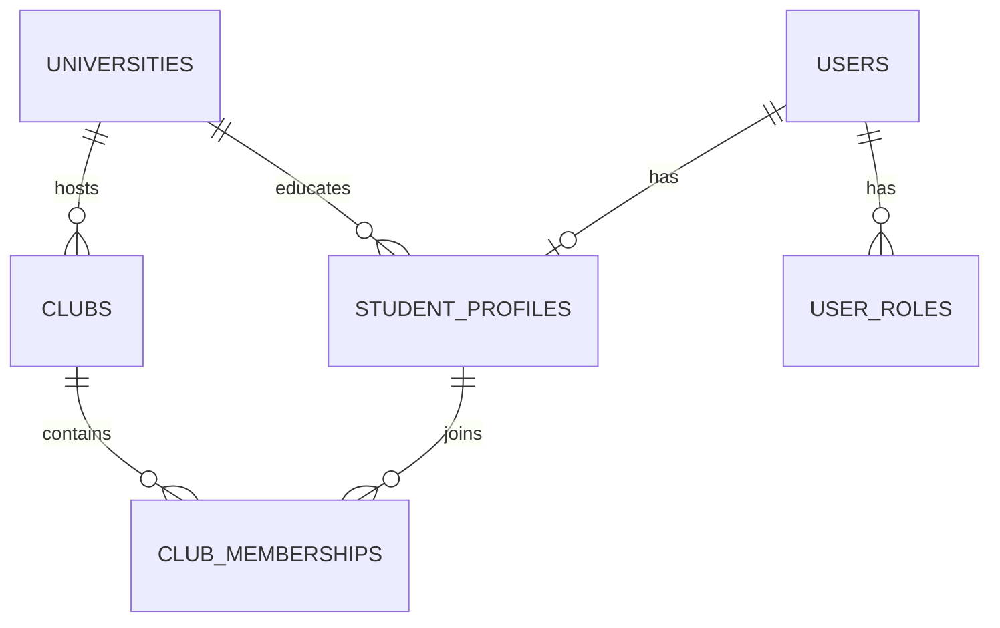

# Campus+ — Üniversite, öğrenci profili, kulüp ve üyelik tasarımı

Durum güncellemesi (2026-10-19): Tasarım kullanıcı tarafından onaylandı. University/StudentProfile
ve V003 önceki aşamada tamamlandı. Club/ClubMembership geliştirildi; V004/V005 açık kullanıcı
onayıyla yalnızca Campus+ PostgreSQL 17'ye uygulandı. **164 otomatik test ve 93 canlı kontrol geçti.**
Aşağıdaki bölüm başlangıç tasarımıdır; gerçekleşen API sözleşmesi, migration ve test sonuçları
[kulüp aşama raporunda](club-phase-review.md). Git işlemleri ayrıca kullanıcı onayıyla yürütülür.

## 1. Kapsam ve temel kararlar

Java 21, Spring Boot 4.1.1, Spring Security 7, Spring Data JPA ve PostgreSQL 17
korunacak. Yeni framework veya bağımlılık gerekmiyor. Paket kökü
`com.campusplus.backend` ve mevcut controller/service/repository/dto/entity/security
katmanları korunur; DTO ve policy sınıfları modülüne göre alt paketlere ayrılabilir.

- `User`: kimlik, hesap bilgileri, parola hash'i ve platform rolleri.
- `StudentProfile`: üniversite ve bölüm gibi akademik bilgiler; User'dan ayrı yaşam döngüsü.
- `University`: üniversite kataloğu, öğrenci profilleri ve kulüplerin bağlı olduğu kurum.
- `Club`: tek üniversiteye bağlı kulüp; bir üniversitenin çok sayıda kulübü olabilir.
- `ClubMembership`: öğrenci ile kulüp arasındaki zengin ilişki; rol ve durum taşır.
  Bir öğrenci çok sayıda kulüpte bulunabilir. Doğrudan `@ManyToMany` kullanılmaz.
- Mevcut kullanıcıların profili başlangıçta olmayabilir. Login, JWT ve kendi temel
  profiline erişim çalışmaya devam eder; kulüp başvurusu/oluşturma için profil tamamlanır.
- Varsayılan öneri: öğrenci yalnızca **kendi üniversitesinin** kulüplerine katılabilir
  ve kulüp kurabilir. Başka üniversitelerin aktif kulüplerini görebilir. Üniversiteler
  arası üyelik istenirse bu politika uygulama öncesinde değiştirilebilir.
- Kulüpler admin onayından sonra yayımlanır. Bu bir önerilen ürün kuralıdır.
- Fiziksel silme yerine katalog pasifleştirme ve kulüp arşivleme kullanılır.
  Mevcut kullanıcı verileri taşınmaz, silinmez veya uydurma akademik bilgilerle doldurulmaz.

## 2. İlişkiler

User → StudentProfile 1:0..1; University → StudentProfile 1:N;
University → Club 1:N; StudentProfile ↔ Club N:M, ClubMembership üzerinden.
Kulübün kurucusu ayrı `created_by` alanıdır; mevcut yönetim yetkisinin kaynağı değildir.
Yönetim devri kurucu bilgisini değiştirmez.

## 3. Önerilen tablolar

Tüm yeni zaman alanları `TIMESTAMPTZ`, Java karşılığı `Instant`; uygulama UTC kullanır.
Yeni kök entity'lerde ve üyelikte `version BIGINT NOT NULL DEFAULT 0` bulunur.
Yeni surrogate ID'ler mevcut modelle uyumlu `BIGINT GENERATED BY DEFAULT AS IDENTITY` olur.

### universities

| Alan | Tip / kısıt | Amaç |
| --- | --- | --- |
| id | BIGINT PK | Kimlik |
| code | VARCHAR(30), NOT NULL, UNIQUE | Admin'in tanımladığı değişmez kurum kodu |
| name | VARCHAR(200), NOT NULL | Resmî ad; tekil olmak zorunda değil |
| city | VARCHAR(100), NOT NULL | Şehir |
| country_code | VARCHAR(2), NOT NULL | ISO ülke kodu, ör. TR |
| website_url | VARCHAR(500), nullable | Doğrulanmış http/https adresi |
| active | BOOLEAN NOT NULL DEFAULT TRUE | Yeni profil/üyelik işlemlerine uygunluk |
| created_at / updated_at | TIMESTAMPTZ NOT NULL | Sistem tarafından atanır |
| version | BIGINT NOT NULL DEFAULT 0 | Optimistic locking |

Kurum kodu sunucuda trim + Locale.ROOT büyük harf ile kanonikleştirilir.
Ad üzerinde unique yoktur; yazım benzerliğiyle yanlış kurum birleştirilmez.
Listeleme için `(active, id)` indeksi; arama başlangıçta sayfalı ve sınırlı olacaktır.
Üniversite silinmez; pasifleştirilmesi bağlı verileri veya login'i silmez.

### student_profiles

| Alan | Tip / kısıt | Amaç |
| --- | --- | --- |
| user_id | BIGINT PK, FK → users.id | Kullanıcı başına tek profil, paylaşılan PK |
| university_id | BIGINT NOT NULL, FK → universities.id | Güncel üniversite |
| department | VARCHAR(150), NOT NULL | Bölüm bilgisi |
| study_year | SMALLINT nullable, CHECK 0..8 | 0 hazırlık; null belirtilmemiş |
| bio | VARCHAR(1000), nullable | İsteğe bağlı açıklama |
| created_at / updated_at | TIMESTAMPTZ NOT NULL | Sistem zamanı |
| version | BIGINT NOT NULL DEFAULT 0 | Yarışan güncellemeleri engelleme |

`university_id` indekslenir. Bölüm şimdilik kontrollü uzunlukta metindir;
ileride Department kataloğu ayrı, onaylı migration ile eklenebilir.
Öğrenci numarası, kimlik belgesi ve doğrulanmış öğrenci iddiası bu dört model için
zorunlu değildir; gereksiz hassas veri toplanmaz. Profil oluşturmak öğrenciliği
resmî olarak doğrulamak anlamına gelmez.

Üniversite değişikliği yalnızca PENDING/ACTIVE/SUSPENDED üyeliği olmayan kullanıcıya
izin verir. Öğrenci ayrılmalı veya bekleyen başvurularını iptal etmelidir. LEFT,
REJECTED ve REMOVED kayıtlar tarihçe olarak korunur; farklı üniversitedeki eski
üyelik yeniden etkinleştirilemez. Kontrol ve değişiklik aynı transaction'da,
üyelik başvurusuyla aynı kullanıcı kilidi altında yapılır.

### clubs

| Alan | Tip / kısıt | Amaç |
| --- | --- | --- |
| id | BIGINT PK | Kulüp kimliği |
| university_id | BIGINT NOT NULL, FK → universities.id | Bağlı kurum |
| created_by | BIGINT NOT NULL, FK → users.id | Değişmez kurucu kaydı |
| name | VARCHAR(150), NOT NULL | Görünen ad |
| slug | VARCHAR(100), NOT NULL | Kurum içinde değişmez URL kimliği |
| description | VARCHAR(5000), NOT NULL | Açıklama |
| logo_url | VARCHAR(500), nullable | Sonraki dosya modülüne kadar isteğe bağlı URL |
| status | VARCHAR(24), NOT NULL | PENDING_APPROVAL / ACTIVE / REJECTED / SUSPENDED / ARCHIVED |
| review_note | VARCHAR(1000), nullable | Kurucu ve admin'e özel değerlendirme gerekçesi |
| reviewed_by / reviewed_at | users FK nullable / TIMESTAMPTZ nullable | Admin değerlendirmesi |
| created_at / updated_at | TIMESTAMPTZ NOT NULL | Sistem zamanı |
| version | BIGINT NOT NULL DEFAULT 0 | Optimistic locking |

`UNIQUE(university_id, slug)` ve `(university_id, status, id)` indeksi.
Slug sunucuda ASCII küçük harf/rakam/tireye dönüştürülür ve değişmez tutulur;
boş veya çakışan slug 400/409 üretir. Farklı üniversiteler aynı slug'ı kullanabilir.
Arşivlenmiş kulübün slug'ı geçmiş bağlantıları korumak için yeniden kullanılmaz.
Aynı görünen adın anlamlı olup olmadığı admin incelemesinde değerlendirilir.

Kulüp oluşturma university_id'yi kullanıcının profilinden alır; istemci farklı bir
üniversiteye kulüp kaydedemez. Sonradan üniversite taşıma bu aşamada desteklenmez.
Görsel URL'si sunucu tarafından indirilmez; haricî URL üzerinden SSRF yolu açılmaz.

### club_memberships

| Alan | Tip / kısıt | Amaç |
| --- | --- | --- |
| id | BIGINT PK | Üyeliğin sabit kimliği |
| club_id | BIGINT NOT NULL, FK → clubs.id | Kulüp |
| user_id | BIGINT NOT NULL, FK → student_profiles.user_id | Profil sahibi öğrenci |
| role | VARCHAR(16), NOT NULL | MEMBER / MANAGER / OWNER |
| status | VARCHAR(16), NOT NULL | PENDING / ACTIVE / REJECTED / LEFT / REMOVED / SUSPENDED |
| requested_at | TIMESTAMPTZ NOT NULL | Son başvuru zamanı |
| joined_at | TIMESTAMPTZ nullable | Son kabul zamanı |
| ended_at | TIMESTAMPTZ nullable | Ayrılma/çıkarılma zamanı |
| reviewed_by / reviewed_at | users FK nullable / TIMESTAMPTZ nullable | Karar veren ve zaman |
| decision_reason | VARCHAR(1000), nullable | Üye ve yetkili yöneticilere özel |
| created_at / updated_at | TIMESTAMPTZ NOT NULL | Sistem zamanı |
| version | BIGINT NOT NULL DEFAULT 0 | Yarışan değişiklikler |

- `UNIQUE(club_id, user_id)`: aynı öğrenci/kulüp için tek güncel ilişki.
- Yeniden başvuru aynı satırı kullanır; geçmiş geçişler ileride audit modülüne taşınabilir.
  Bu dört tablo tek başına tüm üyelik değişikliklerinin değişmez audit geçmişi değildir.
- `(user_id, status, id)` ve `(club_id, status, role, id)` indeksleri.
- Aktif OWNER için club_id üzerinde partial unique index: en fazla bir aktif sahip.
- Role/status değerleri DB CHECK ile sınırlandırılır. ACTIVE olmayan satır MEMBER
  olmalıdır; yönetim yetkisi askıya alınmadan önce role MEMBER'e indirilir.
- OWNER bulunması çapraz satır kuralıdır; CHECK ile garanti ediliyormuş gibi davranılmaz.
  Arşivlenmemiş her kulübün tam bir aktif OWNER'ı olması servis transaction'ında korunur.
- Tüm yeni foreign key'lerde varsayılan yaklaşım RESTRICT/NO ACTION'dır; toplu cascade
  silme yoktur. İlişkili verisi olan bir kullanıcıyı silme girişimi güvenli 409 üretir;
  mevcut hesap silme davranışı bu yönden test edilmelidir. Anonimleştirme ayrı politikadır.

## 4. JPA ilişkileri ve yükleme

- StudentProfile.user: `@OneToOne(fetch=LAZY, optional=false)` + `@MapsId`;
  profil PK'sı user_id'dir. User'a zorunlu ters ilişki eklemek gerekmez.
- StudentProfile.university: `@ManyToOne(fetch=LAZY, optional=false)`.
- Club.university ve Club.createdBy: `@ManyToOne(fetch=LAZY, optional=false)`.
- ClubMembership.club ve .studentProfile: `@ManyToOne(fetch=LAZY, optional=false)`.
- reviewedBy ilişkileri nullable ve LAZY'dir. Yeni entity'lerde `Long @Version` kullanılır;
  yeni entity'de null sürüm, özellikle paylaşılan PK'lı profilde isNew/persist tespitini destekler.
- Parent koleksiyonları yalnızca kullanım gerektirirse eklenir; büyük üyelik listeleri
  repository'den sayfalı çekilir. Entity'ler API'de serialize edilmez.
- Universities/users yönüne `CascadeType.ALL`, REMOVE veya orphanRemoval uygulanmaz.
- DTO mapping transaction içinde yapılır. Projection veya hedefli EntityGraph ile
  N+1 önlenir; sayfalı koleksiyon sorgusuna collection fetch join eklenmez.
- Yeni servisler sorgular için readOnly transaction, yazmalar için açık transaction kullanır.
  Mevcut User.roles EAGER davranışı bu aşamada gereksiz yere değiştirilmez.

## 5. Rol ve kaynak yetkileri

Platform ADMIN rolü ve kulüp OWNER/MANAGER rolü farklı kavramlardır:

- STUDENT: uygun kulübe başvuru, kendi üyeliğini görme/iptal/ayrılma ve kendi öğrenci profili.
- CLUB_ADMIN: tek başına hiçbir kulübün yönetimine erişim sağlamaz.
- Kulüp yönetimi: ADMIN veya **güncel CLUB_ADMIN + ilgili club_id için ACTIVE
  OWNER/MANAGER üyeliği** gerekir. Kulüp durumuna göre yapılabilecek işlemler ayrıca sınırlandırılır.
- Kulüp oluşturma STUDENT ve tamamlanmış uygun profil gerektirir; önceden CLUB_ADMIN
  olmak gerekmez. Aynı transaction kulübü, kurucunun ACTIVE OWNER üyeliğini ve
  CLUB_ADMIN rolünü oluşturur. Başlangıçta kulüp PENDING_APPROVAL'dır.
- İlk aktif yönetici üyeliğinde CLUB_ADMIN eklenir. Son aktif yönetici üyeliği bittiğinde,
  başka arşivlenmemiş kulüpte yönetici üyeliği yoksa CLUB_ADMIN kaldırılır. STUDENT ve
  ADMIN korunur. Kulüp arşivlemede de etkilenen yöneticilerin marker rolleri tekrar
  hesaplanır; tarihsel üyelikler silinmez. Rol ve üyelik değişikliği aynı transaction'da gerçekleşir.
- Rol marker'ı yalnızca liste/UI için güvenilir değildir; her yönetim işleminde gerçek
  üyelik ve club.status tekrar kontrol edilir. JWT'ye üyelik listesi gömülmez.
- MANAGER: üye başvurusu değerlendirme, sıradan üyeyi çıkarma ve ACTIVE kulüp bilgilerini
  düzenleme. Yönetici atama, OWNER'a müdahale ve sahiplik devri yapamaz.
- OWNER: manager atama/indirme, sahiplik devri ve kulübü arşivleme de yapabilir.
  Kendini son sahipken ayrılma/çıkarma veya MEMBER'e indirme yoktur: 409.
- ADMIN: platform denetimi, kulüp onayı/askıya alma, gerekli sahiplik düzeltmesi.
  Admin müdahalesi de OWNER bütünlüğünü atlayamaz. Otomatik ADMIN ataması yapılmaz.
- PENDING_APPROVAL/REJECTED kulüp: yalnızca kurucu-sahip ve ADMIN görüp taslak bilgilerini
  düzenler; üyelik başvurusu alamaz. OWNER düzenleyip tekrar incelemeye gönderebilir.
- SUSPENDED kulüp: kamu listesinden çıkar; yönetim/sıradan başvurular kapalıdır.
  Mevcut üyeler kendi üyeliklerini görebilir ve OWNER dışındakiler ayrılabilir.
- ARCHIVED kulüp: yeni başvuru ve yönetim kapalı; geçmiş üyelikler korunur.
  Admin ve geçmiş üyeler yetkileri ölçüsünde okuyabilir; geri açma bu aşamada yoktur.
- Etkisiz/inaktif üniversiteye yeni profil veya kulüp başvurusu oluşturulmaz.
  Üniversite pasifleştirme mevcut kimlik doğrulamayı iptal etmez.

`StudentProfilePolicy`, `ClubPolicy`, `ClubMembershipPolicy` ayrı bean'ler olur.
Servislerde `@PreAuthorize` ilk rol/sahiplik kontrolünü yapar; kilitlenen transaction
verileri üzerinde durum ve üyelik yeniden denetlenir. Controller tek güvenlik katmanı değildir.
Membership ID verilen istekte satırın istenen club_id'ye bağlı olduğu da doğrulanır.

401 eksik/geçersiz authentication; 403 bilinen kaynağa yetkisizlik; görünürlüğü olmayan
kulüp için 404; kural/unique/version çakışması 409; geçersiz payload 400.
Bu davranışlar endpoint sözleşmesinde sabitlenir; hata yanıtları gizli alan içermez.

## 6. Üyelik durum akışı ve eşzamanlılık

- İlk başvuru → PENDING, MEMBER. Tekrarlanan PENDING/ACTIVE başvuru yeni satır oluşturmaz,
  mevcut durumu değiştirmeden 409 verir.
- PENDING → ACTIVE veya REJECTED: kulübün yetkili OWNER/MANAGER'ı veya ADMIN.
- PENDING → LEFT: başvuranın iptali; ACTIVE → LEFT: üyenin ayrılması.
- LEFT/REJECTED → PENDING: yeni uygun başvuru; aynı üniversite ve aktif kulüp tekrar kontrol edilir.
  Yeniden başvuru rate limit politikasına tabidir; süre ilk uygulama öncesinde yapılandırılır.
- ACTIVE MEMBER → REMOVED: yetkili yönetici; REMOVED'dan kendiliğinden yeniden başvuru yoktur,
  yönetici yeniden başvuruyu açar. Bu izin ayrı action ile REJECTED'a geçiş olarak tutulabilir.
- ACTIVE MEMBER/MANAGER → SUSPENDED: ADMIN; role MEMBER'e iner. Yeniden etkinleştirme
  yalnızca ADMIN ile ACTIVE MEMBER yapar; eski yönetici yetkisi otomatik dönmez.
- Sahiplik devri yalnızca aynı kulüpteki ACTIVE, uygun profilli bir üyeye yapılır.
  Eski OWNER MANAGER olur. Eski ve yeni sahip güncellemeleri birlikte commit edilir.
- OWNER'ın askıya alınması/çıkarılması önce devir veya kulüp arşivleme gerektirir.

Her üyelik/rol mutasyonu aynı kulüp satırını pessimistic write lock ile kilitler;
son OWNER ve iki eşzamanlı onay/devir bu kilit altında değerlendirilir. Kullanıcıya
ait başvuru/profil değişiklikleri aynı users satırındaki lock ile eşgüdümlenir.
Kilit sırası: etkilenen users ID'leri artan sırada → clubs ID'leri artan sırada → üyelikler.
Devir/arşivleme için etkilenen kimlikler önceden okunur; kilit alındıktan sonra version
ve üye kümesi tekrar doğrulanır. Değişmişse kısmi işleme devam edilmez; 409/retry gerekir.
Tüm ilgili yazma yolları aynı sırayı izler; istemci denetimli lock sırası kullanılmaz.

Sahiplik devrinde partial unique index anlık ihlal edilmesin diye kilit/transaction altında
eski OWNER MANAGER'a indirilip flush edilir, sonra hedef OWNER yapılır. İkinci adım
başarısızsa transaction her ikisini de geri alır. Sıfır sahipli ara durum commit edilmez.
Her güncellemede request.version sunucudaki @Version ile karşılaştırılır;
OptimisticLockException ve deadlock/lock timeout güvenli çakışma yanıtına dönüştürülür.

## 7. REST API önerisi

Mevcut `/api/users` ve `/api/auth` sözleşmeleri korunur. Aşağıdaki katalog dahil bütün
yeni endpoint'ler başlangıçta JWT gerektirir; guest erişim ayrıca değerlendirilir.
Listeleme: `page` 0+, `size` 1..100; sıralama allowlist ve sabit id tie-breaker kullanır.

| Endpoint | İzin / davranış |
| --- | --- |
| GET /api/universities?query=&page=&size= | Doğrulanmış kullanıcı; aktif katalog |
| GET /api/universities/{id} | Doğrulanmış kullanıcı; görünür kurum |
| POST /api/universities | ADMIN, 201 |
| PATCH /api/universities/{id} | ADMIN, version ile güncelleme/pasifleştirme |
| GET /api/me/student-profile | Kendi profili; yoksa 404 |
| POST /api/me/student-profile | Kendi profilini oluşturma, 201; varsa 409 |
| PUT /api/me/student-profile | Kendi profilini güncelleme, version |
| GET /api/admin/users/{userId}/student-profile | ADMIN; özel akademik görünüm |
| PUT /api/admin/users/{userId}/student-profile | ADMIN; aynı bütünlük kuralları |
| GET /api/clubs?universityId=&query=&page=&size= | Aktif kulüplerin sayfalı özeti |
| GET /api/clubs/{id} | Görünürlük politikasına göre detay |
| POST /api/clubs | Uygun öğrenci; kendi üniversitesinde PENDING_APPROVAL, 201 |
| PATCH /api/clubs/{id} | İlgili OWNER/MANAGER veya ADMIN, version |
| POST /api/clubs/{id}/resubmit | REJECTED kulübün OWNER'ı |
| POST /api/clubs/{id}/archive | OWNER veya ADMIN; fiziksel silme yok |
| POST /api/admin/clubs/{id}/approve | ADMIN; PENDING_APPROVAL → ACTIVE |
| POST /api/admin/clubs/{id}/reject | ADMIN; PENDING_APPROVAL → REJECTED |
| POST /api/admin/clubs/{id}/suspend | ADMIN; ACTIVE → SUSPENDED |
| POST /api/admin/clubs/{id}/restore | ADMIN; SUSPENDED → ACTIVE |
| GET /api/admin/clubs?status= | ADMIN inceleme kuyruğu |
| POST /api/clubs/{id}/membership-requests | Kendi adına başvuru, userId alınmaz; 201/200 reapply |
| GET /api/me/club-memberships?status= | Kendi başvuru ve üyelikleri |
| GET /api/clubs/{id}/memberships?status= | Yalnızca ilgili yönetici/ADMIN; sayfalı yönetim görünümü |
| POST /api/clubs/{id}/memberships/{membershipId}/approve | İlgili yönetici/ADMIN |
| POST /api/clubs/{id}/memberships/{membershipId}/reject | İlgili yönetici/ADMIN |
| POST /api/clubs/{id}/membership/cancel | Kendi PENDING başvurusunu iptal |
| POST /api/clubs/{id}/membership/leave | Kendi üyeliğinden ayrılma; OWNER için 409 |
| POST /api/clubs/{id}/memberships/{membershipId}/remove | Yerel role göre yönetici/ADMIN |
| POST /api/clubs/{id}/memberships/{membershipId}/allow-reapplication | OWNER/MANAGER/ADMIN; REMOVED → REJECTED |
| PATCH /api/clubs/{id}/memberships/{membershipId}/role | OWNER/ADMIN; yalnızca MEMBER ↔ MANAGER |
| POST /api/clubs/{id}/ownership-transfer | OWNER/ADMIN; ACTIVE üyeye kontrollü devir |
| POST /api/admin/clubs/{id}/memberships/{membershipId}/suspend | ADMIN, OWNER kuralı korunur |
| POST /api/admin/clubs/{id}/memberships/{membershipId}/restore | ADMIN; ACTIVE MEMBER olarak dönüş |

Başarılı state action'ları güncel güvenli DTO ve 200 döndürür. Tüm action istekleri
version içerir; zaten uygulanmış/uygunsuz durum güvenli 409 üretir. Genel role/status
PATCH'iyle herhangi bir geçişe izin verilmez. Fotoğraf yükleme ayrı sonraki modüldür.

## 8. DTO sözleşmeleri

| DTO | Alanlar / kural |
| --- | --- |
| CreateUniversityRequest | code, name, city, countryCode, websiteUrl?; uzunluk ve URL doğrulama |
| UpdateUniversityRequest | name?, city?, websiteUrl?, active?, version; code değişmez |
| UniversitySummary / UniversityResponse | id, code, name, city, countryCode; detayda URL, active, version |
| CreateStudentProfileRequest | universityId, department, studyYear?, bio?; userId yok |
| UpdateStudentProfileRequest | universityId, department, studyYear?, bio?, version |
| StudentProfileResponse | userId, university özeti, department, studyYear, bio, version; yalnızca kendisi/ADMIN |
| CreateClubRequest | name, slug, description, logoUrl?; universityId/creator/status/role yok |
| UpdateClubRequest | name?, description?, logoUrl?, version; kurum/slug/status değişmez |
| ClubSummary | id, university özeti, name, slug, logoUrl, activeMemberCount |
| ClubResponse | özet + description, görünür status, version; reviewNote yalnızca özel review DTO'da |
| ClubReviewRequest | reason?, version; reject/suspend için reason zorunlu |
| MembershipApplyRequest | version nullable; ilk başvuruda boş olabilir, mevcut LEFT/REJECTED satırda zorunlu |
| MyMembershipResponse | id, club özeti, role, status, requestedAt, joinedAt, decisionReason?, version |
| ManagedMembershipResponse | id, userId, displayName, role, status, times, version; email/parola/bio yok |
| MembershipDecisionRequest | reason?, version; reject/remove/suspend için reason zorunlu |
| ChangeMembershipRoleRequest | role: MEMBER veya MANAGER, version; OWNER seçilemez |
| TransferOwnershipRequest | targetMembershipId, clubVersion, ownerMembershipVersion, targetMembershipVersion |
| PageResponse<T> | content, page, size, totalElements, totalPages; framework iç yapısını ifşa etmez |

Boş patch 400; null ile alan silme semantiği açıkça tanımlanır, zorunlu alanlar null yapılamaz.
ID, actor, createdAt, status ve global roller sunucuda atanır. DTO'lar entity değildir;
istekler `@Valid`, alan sınırları DB ile uyumludur. Public DTO'lar özel profile/reviewNote
alanlarını içermez; üyelik listeleri tüm öğrencilere açılmaz.

## 9. Migration ve uygulama sırası — şu anda uygulanmayacak

1. Tasarım, aynı üniversite kuralı ve kulüp onay akışı için kullanıcı onayı.
2. Yalnızca 127.0.0.1:5434/campus_plus PostgreSQL 17 hedefinin salt okunur doğrulanması;
   users/user_roles satır sayıları ve özetlerinin kaydı. Başka DB veya Docker yok.
3. Ayrı şema uygulama onayı sonrasında V003: universities ve student_profiles.
4. V004: clubs; V005: club_memberships, enum CHECK'leri ve indeksleri.
   Dosya sürümleri uygulama gününde mevcut migration listesiyle tekrar kontrol edilir.
5. Yeni tablolar başlangıçta boş; mevcut kullanıcılara sahte profil/üniversite oluşturulmaz.
   İlk üniversite kayıtları açıkça onaylanmış katalog/API üzerinden girilir; canlı gerçek veri seed edilmez.
6. Her migration hedef/sürüm kontrolü, transaction ve sınırlı lock/statement timeout
   içerir. V001/V002 tekrar çalıştırılmaz. `ddl-auto=validate` korunur.
7. JPA eşlemesi ve yeni şema validate edilir; users/user_roles verilerinin korunduğu doğrulanır.
8. Önce üniversite/profil API'leri, sonra kulüp başvurusu/onayı, sonra üyelik/yönetim/devri;
   her adım güvenlik testleriyle tamamlanır. Commit/push ayrıca talimat gerektirir.

Bu aşamada Flyway eklenmez veya otomatik baseline yapılmaz. Mevcut açıkça çalıştırılan,
sürümlü migration yaklaşımı korunur. Veri oluşmadan başarısız migration transaction
rollback ile geri alınır. Veri oluştuktan sonra tablo düşürme/veri silme rollback'i yok;
önceki uygulamaya dönmek yeni tabloları bırakır veya ayrı onaylı ileri düzeltme yapılır.

## 10. Güvenlik ve test planı

Mevcut **69 test korunur**. Yeni testler tasarım onayı sonrası yazılır:

- FK, unique, CHECK ve @Version davranışı; profil 1:1 ve öğrenci/kulüp tek üyelik garantisi.
- Profilsiz mevcut kullanıcının login/kendi profil erişimi korunur; akademik işlem kontrollü reddedilir.
- Başka kullanıcının öğrenci profiline IDOR; başvuru payload'ına userId/ADMIN/OWNER/status ekleme.
- Aynı öğrenci çok kulübe katılabilir; farklı üniversite ve inaktif üniversite reddedilir.
- Kulüp A'nın MANAGER'ı B'de işlem yapamaz; sadece global CLUB_ADMIN rolü yetmez.
- ACTIVE olmayan yönetici, rolü alınmış kullanıcı ve askıya alınmış kulüp yazma yapamaz.
- MANAGER başka yönetici atayamaz, OWNER'ı çıkaramaz; platform ADMIN açıkça test edilir.
- Son OWNER ayrılma/indirme/askıya alma; başarılı ve başarısız atomik devir.
- Eşzamanlı çift başvuru/onay, devir/devir, profil üniversitesi değişikliği/başvuru,
  iki kulüpte son yöneticilikten ayrılma ve deadlock/timeout; kısmi rol güncellemesi olmamalı.
- Stale version 409; clubId/membershipId karışımı; izinsiz hedef veri yüklenmeden ret.
- Katalog visibility, pasif/reddedilen/askıya alınan/arşivlenen kulüp görünürlüğü.
- UI/API'de özel profile, e-posta, reviewNote, parola/hash ve token sızıntısı olmaması.
- Sayfalama limitleri, kararlı sıralama, sorgu sayısı/N+1 ve büyük üyelik listeleri.
- Servis doğrudan çağrıldığında da method security; 401/403/404/409 sözleşmesi.
- Register/Login/JWT regresyonu; rol ve üyelik iptalinin eski token'la sonraki istekte etkisi.

Mock MVC ve servis testleri yanında constraint/locking doğrulaması gerçek PostgreSQL 17
özellikleri gerektirir. Bunun için ayrı Campus+ test veritabanı/şeması oluşturulması
ayrıca onaylanmalıdır; mevcut campus_plus üzerinde destructive test/cleanup yapılmaz.
Kullanıcının yasakladığı Docker ortamlarına test amacıyla da dokunulmaz.

## 11. Gelecek modüllerle entegrasyon

- Event ve Announcement: `club_id`, `created_by`; yazma için aynı ClubPolicy.
- EventParticipation: event_id + user_id; üyelik gerekliliği etkinlik politikasıyla belirlenir.
- Comment ve Like: değişmez author/actor kullanıcı kimliği; kendi içeriği ve moderasyon ayrılır.
  Gerçek FK'li model tercih edilir; yalnızca target_type/target_id ile bütünlükten vazgeçilmez.
- Messaging: conversation/participant ilişkisi; kulüp yöneticiliği özel mesajları okuma hakkı vermez.
- Notification: alıcı user_id ve ilgili kaynak kimliği. Üyelik onayı/ret, devir ve kulüp
  durum değişiklikleri olay üretmeye uygundur; transaction rollback'inde bildirim gitmez.
- İlk modüllerde domain event sınırları belirlenir. Güvenilir asenkron teslim ihtiyacında
  ayrı onaylı outbox migration'ı planlanır; yalnızca in-memory event kalıcı teslim garantisi değildir.
- Kulüp yöneticisinin diğer modüllerde yetkisi de güncel club membership/status üzerinden
  hesaplanır. Token'a ayrı event/comment yetkileri yığılmaz; platform RBAC + kaynak policy birleşir.

## 12. İncelenen teknik kaynaklar

Bu ürün kuralları Campus+ için öneridir. Teknik dayanaklar:

- [Spring Data JPA locking](https://docs.spring.io/spring-data/jpa/reference/jpa/locking.html)
- [Spring Security method security](https://docs.spring.io/spring-security/reference/servlet/authorization/method-security.html)
- [PostgreSQL 17 constraints ve veri tanımı](https://www.postgresql.org/docs/17/ddl.html)

## Onay noktası

Önerilen varsayılanlar: aynı üniversitede üyelik/kuruculuk, admin onaylı kulüp açılışı,
tek OWNER ve birden fazla MANAGER, öğrenciye özel akademik profil, üyelikle sınırlı yönetim.
Tasarım onaylandıktan sonra önce migration'ın kesin SQL'i hazırlanıp şema uygulama onayı
alınacak. **Bu belge onay veya çalıştırılmış migration yerine geçmez.**
